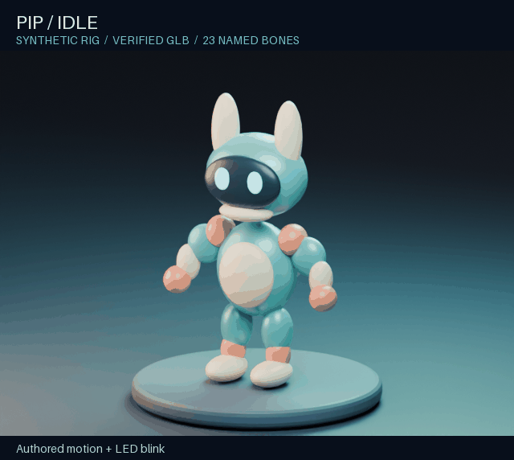

# Companion Animation Pipeline

[](https://github.com/arabianguy08/companion-animation-pipeline/actions/workflows/tests.yml)

**Inspect → calibrate → animate → export → verify → review → package.**

A standalone Blender pipeline for 3D characters and companions, with a Python
CLI, an installable AI skill, and a local MCP server that controls background
Blender jobs. Keep model-specific work resumable, source files intact, and
successful export separate from successful animation.

## See it work



The public showcase uses only newly generated synthetic geometry. It contains
no private models, game code, customer data, or recordings from another product.
See [the showcase and its evidence](docs/SHOWCASE.md).

## Install once

The installer sets up **uv, Python 3.12, the CLI, MCP dependencies, an AI skill,
and Blender**. It reuses an existing Blender or installs a portable,
checksum-verified Blender 4.5.3 build in your user data directory. No separate
Blender add-on, Node.js, Git installation, API key, or subscription is required.

### Windows PowerShell

```powershell
Invoke-RestMethod https://raw.githubusercontent.com/arabianguy08/companion-animation-pipeline/v0.1.1/install.ps1 -OutFile install.ps1
.\install.ps1 -Client codex
```

### macOS / Linux

```sh
curl -LsSf https://raw.githubusercontent.com/arabianguy08/companion-animation-pipeline/v0.1.1/install.sh -o install.sh
sh install.sh --client codex
```

Choose `codex`, `claude-code`, `claude-desktop`, `cursor`, or `generic` instead.
The first four configure their MCP connection automatically; restart the AI
client afterward. That client's normal tool-approval rules still apply.
`auto` registers a uniquely detected Codex/Claude CLI; otherwise it writes a
portable `companion-mcp.json` rather than guessing which app to change.

Use `-ManagedBlender` / `--managed-blender` to install the pinned build even when
Blender is already present. Use `-Blender` / `--blender` for your own executable.
Client applications themselves are not installed. See [setup details](docs/SETUP.md).

## First run

```sh
companion-animation doctor
companion-animation demo ./my-first-demo
```

The demo creates an original synthetic rig and face, bakes real actions, exports
a GLB, reopens it, verifies deformation/timing and renders inspection evidence.
Packaging still requires real visual review. Nothing is uploaded.

For your own model:

```sh
companion-animation init model.json --model ./character.glb --workspace ./work
companion-animation inspect model.json
companion-animation status model.json
```

Tell your agent:

> Use the companion-animation-pipeline skill and MCP tools. Inspect my model,
> calibrate its anatomy and named bones, preserve its original proportions and
> authored motion, and produce a numerically verified GLB with playback for review.

Then follow [the usage guide](docs/USAGE.md).

## What is automated—and what needs judgment

- Shared stages: inspection, job isolation, baking, GLB export, numerical checks,
  probe rendering, cache invalidation, resumption and packaging.
- Model-specific work: anatomical fitting, weights, bone mapping, clip selection,
  facial geometry and believable motion. An AI can do this through the included
  Blender tools, but an arbitrary upload is **not** a guaranteed one-click rig.
- Numerical certification checks the persisted GLB, not just an animation name.
  Temporal/artistic quality still needs inspection. Supplied clips keep their
  exact timing, loop/hold behavior and action-slot binding.
- VFX examples show presentation and timing. Projectile movement, collision,
  combat logic and mobile performance belong to the consuming application.

## Developers

```sh
python -m pip install .
python -m unittest discover -s tests -v
python tests/test_pipeline.py --blender /path/to/blender BlenderTests -v
```

The runner itself uses the Python standard library; Blender supplies `bpy`,
NumPy and mathutils. The MCP interface uses the official MCP Python SDK 1.x.
[Verification](docs/VERIFICATION.md) distinguishes real Blender checks, unit
tests, visual review and untested platforms.

## Local execution and licensing

The MCP server uses stdio and opens no HTTP port. `blender_script` executes
trusted local Python with your account permissions; this is not a sandbox.
Adapters and models stay local unless you explicitly share them. Read install
scripts before running downloaded code.

Pipeline code and synthetic showcase material: [MIT](LICENSE). Blender is a
separate application with [its own license](https://www.blender.org/about/license/).
Dependency licenses remain with their respective projects.
